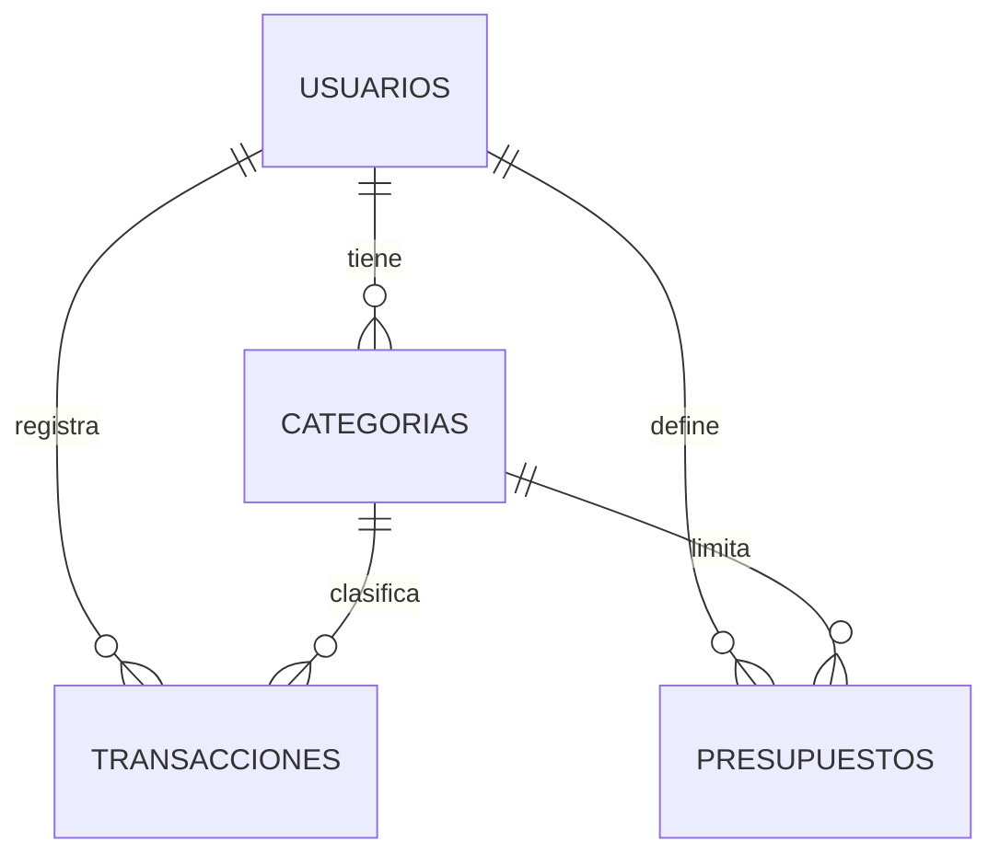

# Esquema de la base de datos FINTRACK

Este documento describe las tablas del backend. Las migraciones Alembic en `backend/migrations/versions/` son la fuente de verdad ejecutable del esquema.

- **Producción:** PostgreSQL en Neon.
- **Desarrollo local y pruebas:** SQLite.
- **Aplicación de migraciones:** `flask --app run db upgrade` desde `backend/`.

## Relaciones

`REVOKED_TOKENS` se relaciona con los JWT revocados por su identificador `jti`; no tiene clave foránea a `USUARIOS`.

## Tablas

### `usuarios`

| Columna | Tipo | Reglas |
|---|---|---|
| `id_usuario` | Integer | Clave primaria |
| `nombre` | String(100) | No nulo |
| `correo` | String(150) | No nulo, único e indexado |
| `password_hash` | String(255) | No nulo; almacena un hash, nunca la contraseña en texto |
| `fecha_registro` | DateTime | No nulo |
| `activo` | Boolean | No nulo; verdadero por defecto |

### `categorias`

| Columna | Tipo | Reglas |
|---|---|---|
| `id_categoria` | Integer | Clave primaria |
| `id_usuario` | Integer | FK a `usuarios.id_usuario`, no nulo e indexado |
| `nombre` | String(80) | No nulo |
| `tipo` | String(10) | No nulo; validado por la API |
| `descripcion` | String(255) | Opcional |
| `fecha_creacion` | DateTime | No nulo |

Restricción única: (`id_usuario`, `nombre`, `tipo`).

### `transacciones`

| Columna | Tipo | Reglas |
|---|---|---|
| `id_transaccion` | Integer | Clave primaria |
| `id_usuario` | Integer | FK a `usuarios.id_usuario`, no nulo e indexado |
| `id_categoria` | Integer | FK a `categorias.id_categoria`, no nulo e indexado |
| `tipo` | String(10) | No nulo; validado por la API |
| `monto` | Numeric(12,2) | No nulo y mayor que cero |
| `moneda` | String(3) | No nulo; validada por la API |
| `descripcion` | String(255) | Opcional |
| `fecha` | Date | No nulo e indexado |
| `fecha_registro` | DateTime | No nulo |

### `presupuestos`

| Columna | Tipo | Reglas |
|---|---|---|
| `id_presupuesto` | Integer | Clave primaria |
| `id_usuario` | Integer | FK a `usuarios.id_usuario`, no nulo e indexado |
| `id_categoria` | Integer | FK a `categorias.id_categoria`, no nulo e indexado |
| `monto_limite` | Numeric(12,2) | No nulo y mayor que cero |
| `moneda` | String(3) | No nulo; validada por la API |
| `mes` | Integer | No nulo |
| `anio` | Integer | No nulo |
| `fecha_creacion` | DateTime | No nulo |

Restricción única: (`id_usuario`, `id_categoria`, `moneda`, `mes`, `anio`).

### `revoked_tokens`

| Columna | Tipo | Reglas |
|---|---|---|
| `jti` | String(36) | Clave primaria; identificador único del JWT |
| `expires_at` | Integer | No nulo e indexado; expiración del token |
| `revoked_at` | DateTime | No nulo |

## Historial del esquema

1. `44791ec6011f_initial_fintrack_schema`: crea `usuarios`, `categorias`, `transacciones` y `presupuestos`, con sus claves, índices y restricciones.
2. `8dbe0c31a923_revoked_jwt_tokens`: agrega `revoked_tokens` para invalidar sesiones cerradas.

Para crear o actualizar las tablas, ejecuta las migraciones; no uses `db.create_all()` en producción.
