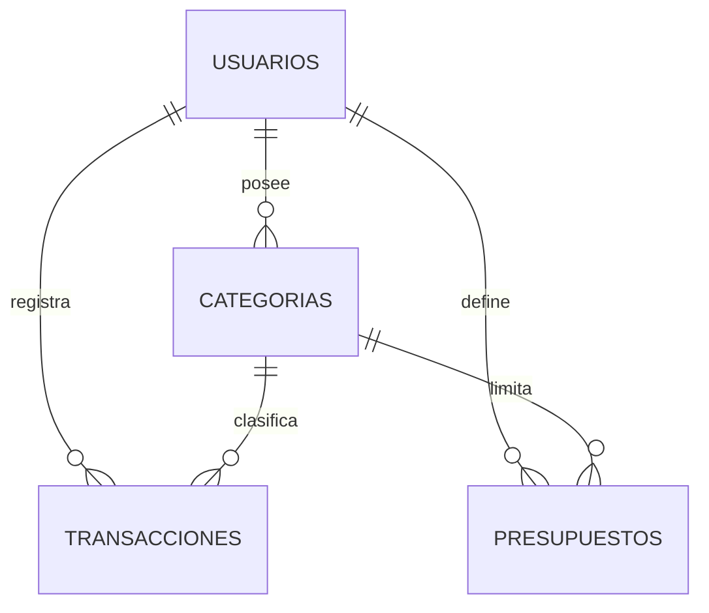

# Modelo de datos

FINTRACK almacena cuatro entidades en SQLite. Todas las relaciones usan claves foráneas; la conexión SQLite activa `PRAGMA foreign_keys=ON`.

## Entidades

| Tabla | Campos principales | Restricciones |
|---|---|---|
| `usuarios` | `id_usuario`, `nombre`, `correo`, `password_hash`, `fecha_registro`, `activo` | Correo único; contraseña almacenada con hash Werkzeug. |
| `categorias` | `id_categoria`, `id_usuario`, `nombre`, `tipo`, `descripcion`, `fecha_creacion` | Tipo `INGRESO`/`GASTO`; combinación usuario/nombre/tipo única. |
| `transacciones` | `id_transaccion`, `id_usuario`, `id_categoria`, `tipo`, `monto`, `moneda`, `descripcion`, `fecha`, `fecha_registro` | Monto positivo `NUMERIC(12,2)`; moneda PEN/USD. |
| `presupuestos` | `id_presupuesto`, `id_usuario`, `id_categoria`, `monto_limite`, `moneda`, `mes`, `anio`, `fecha_creacion` | Monto positivo; combinación usuario/categoría/moneda/mes/año única. |

Los repositorios concentran las consultas, los servicios aplican reglas de negocio y las rutas serializan las respuestas HTTP. Los modelos y cambios de esquema se administran mediante Flask-Migrate.